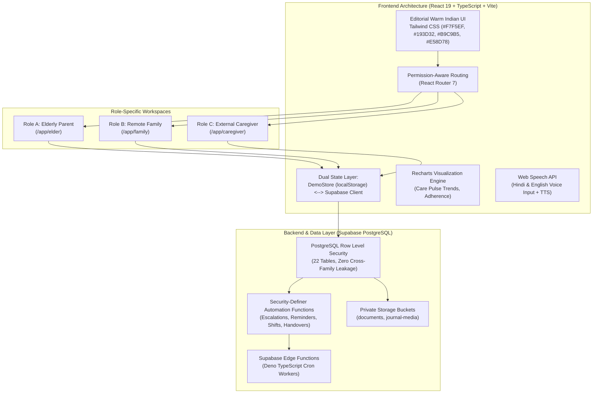

# NANU'S AI — Full-Stack Care Coordination Platform

<div align="center">

```
   _  __ ___   _  __ _   _  ' ____       _    ___ 
  | |/ // _ | / |/ // | / /  / __/      / \  |_ _|
  |   // __ |/    //  |/ /  _\ \       / _ \  | | 
 /_/\_/_/ |_/_/|_//_/|_/   /___/      /_/ \_\|___|
```

### *"Care is love, made visible."*
**Distance shouldn't mean uncertainty.**

[](https://www.typescriptlang.org/)
[](https://react.dev/)
[](https://vitejs.dev/)
[](https://tailwindcss.com/)
[](https://supabase.com/)
[]()

[Product Vision](#1-product-vision--core-thesis) • [Live Demo](#2-sharma-family-demonstration--quick-start) • [Role Experiences](#3-the-three-role-based-experiences) • [Core Modules](#4-the-12-core-application-modules) • [Database Architecture](#5-database-architecture--security) • [Deployment](#6-setup--deployment-guide)

</div>

---

## 1. Product Vision & Core Thesis

When aging parents live in one city, adult children work in another, and external caregivers visit daily, care coordination frequently collapses into fragmented phone calls, frantic WhatsApp messages, forgotten prescriptions, and persistent anxiety.

**NANU'S AI** is a unified family-care accountability ecosystem that bridges this distance. It answers one fundamental question:

> *"When the people we love grow older and we cannot always be there physically, how can we make sure their care never falls through the cracks?"*

### What Nanu's AI is NOT:
- ❌ **NOT** a generic AI chatbot or novelty LLM conversational wrapper.
- ❌ **NOT** an invasive elder surveillance camera or passive monitoring dashboard.
- ❌ **NOT** an arbitrary health score calculator that generates false reassurance or unwarranted panic.
- ❌ **NOT** a standalone medicine reminder app that marks pills taken just because an alarm rang.

### What Nanu's AI IS:
- ✅ **A Shared Family Care Workspace:** Uniting parents, siblings across cities, and professional caregivers in a single permissioned ecosystem.
- ✅ **Independent Dual-Confirmation Medication Architecture:** Separating elder ingestion confirmation from caregiver assistance logs.
- ✅ **Auditable Caregiver Trust & Accountability:** Tracking verified credentials, scheduled shifts, consent-based attendance, and out-of-pocket expenses without arbitrary star ratings.
- ✅ **Structured Shift Handovers:** Signature transitions carrying forward completed tasks, medicine statuses, and unresolved issues.
- ✅ **Private Family Sanctuary:** An encrypted Family Journal and Document Vault keeping cherished moments and sensitive clinical discharge summaries safe from third parties.

---

## 2. Technology Stack & Architectural Overview



### Stack Breakdown

| Layer | Technologies | Key Highlights |
|---|---|---|
| **Framework** | React 19, TypeScript, Vite 8 | Strict typing (`tsc -b`), fast HMR, zero build errors. |
| **Styling** | Tailwind CSS 3.4 | Custom editorial palette, accessible contrast ratios, minimal decoration. |
| **Motion & A11y** | Framer Motion 14 | Fluid transitions with strict `useReducedMotion` compliance. |
| **Visualizations** | Recharts 3.11 | Care Pulse coordination metrics, stacked task activity, dual medication curves. |
| **Forms & Schemas** | React Hook Form 7, Zod 4 | Strict client and server-side input validation and error mapping. |
| **Database** | PostgreSQL (Supabase) | 22 relational tables, foreign key constraints, UTC timestamps, B-tree indexes. |
| **Security** | PostgreSQL RLS | Strict role isolation; caregivers restricted to assigned elders; private family vaults. |
| **Automation** | PL/pgSQL Functions + Edge Functions | Event-driven missed-shift detection, task escalations, and handover aggregation. |
| **Voice & Speech** | Web Speech API | Dual-mode speech recognition & speech synthesis in English and Hindi (हिन्दी). |
| **PWA** | Web App Manifest + Service Worker | Installable on iOS and Android devices as a native-like PWA. |

---

## 3. The Three Role-Based Experiences

Nanu's AI is purposefully built around three distinct cognitive and operational contexts:

### 👵 Role A: The Elderly Parent (`/app/elder`)
Designed specifically for senior family members who need clarity and large touch targets without complex navigation:
- **Ultra-Readable Typography & Contrast:** High-contrast Forest Green (`#193D32`) on Warm Ivory (`#F7F5EF`) with minimum 56–64px tap targets.
- **Today's Medicine Schedule:** Chronological slots showing exact time and name. One-tap response:
  - `Taken` (✓ पुष्टि करें)
  - `Skipped` (छोड़ दिया)
  - `Unable to Confirm` (मदद चाहिए)
- **Bilingual Voice Check-in:** Simple speech commands in English or Hindi:
  - *"I am okay" / "ठीक हूँ"*
  - *"I need help" / "मदद चाहिए"*
  - *"Contact my family" / "परिवार से बात कराएं"*
- **SpeechSynthesis Read-Aloud:** High-clarity audio reading of greetings, schedules, and appointments.
- **Emergency Help SOS:** Single-tap emergency alert triggering instant notifications to all designated children.

### 👩‍💼 Role B: The Remote Child / Family Member (`/app/family`)
Designed for adult children coordinating care from Bengaluru, Mumbai, Delhi, or abroad:
- **The 10-Second Family View:**
  1. *What happened today?*
  2. *Is anything pending?*
  3. *Who is responsible?*
  4. *What needs attention?*
  5. *When was the last confirmed update?*
- **Family Care Pulse (`/app/family/pulse`):** Weekly care coordination volume, medication dual-confirmation trends, and caregiver attendance punctuality.
- **Family Journal (`/app/family/journal`):** Private family memory stream for visit summaries, milestone observations, photos, and sibling comments (completely inaccessible to caregivers).
- **Document Vault (`/app/family/documents`):** Private storage with Document Intelligence preview for human verification of prescriptions and lab reports.
- **Medication Oversight:** Real-time visibility into both parent ingestion and caregiver assistance streams.
- **Care Handover Verification:** Reviewing and acknowledging end-of-shift handover reports.

### 👨‍⚕️ Role C: The Appointed External Caregiver (`/app/caregiver`)
Designed for professional geriatric caregivers who need clear accountability without feeling unfairly scrutinized:
- **Permissioned Family Isolation:** Zero cross-family visibility; access restricted strictly to approved families and elders.
- **Scheduled Shifts & Check-in/Out:** Consent-based arrival and departure tracking with UTC audit timestamps.
- **Task Checklist:** Daily care responsibilities (mobility walks, vitals checks, meal support).
- **Medication Assistance Logging:** Separate logging of assistance given (never misconstrued as proof of ingestion).
- **Out-of-Pocket Care Expense Tracking:** Logging pharmacy purchases, transport costs, and medical supplies with receipt metadata for reimbursement.
- **Care Handover Submission:** Compiling daily shift notes, completed duties, and open issues for the family.

---

## 4. The 12 Core Application Modules

```
 ┌─────────────────────────────────────────────────────────────────────────┐
 │                           NANU'S AI MODULES                             │
 ├────────────────────────┬────────────────────────┬───────────────────────┤
 │ 1. Family Management   │ 2. Medication Tracker  │ 3. Caregiver Trust    │
 │    Roles, invites, RLS │    Dual-confirmation   │    Shifts, expenses   │
 ├────────────────────────┼────────────────────────┼───────────────────────┤
 │ 4. Automation Engine   │ 5. Care Handover       │ 6. Wellness Check-in  │
 │    Missed tasks, cron  │    Structured summaries│    Daily voice pings  │
 ├────────────────────────┼────────────────────────┼───────────────────────┤
 │ 7. Calendar & Clinic   │ 8. Document Vault      │ 9. Family Care Pulse  │
 │    Appointments, rides │    Encrypted + Intel   │    Recharts dashboard │
 ├────────────────────────┼────────────────────────┼───────────────────────┤
 │ 10. Family Journal     │ 11. Voice-First Engine │ 12. Notifications     │
 │     Private memories   │     EN/HI Speech API   │     Deduplicated SMS  │
 └────────────────────────┴────────────────────────┴───────────────────────┘
```

1. **Family Management (`/app/family/members`):** Manage family workspaces, invite siblings and caregivers via unique 10-character cryptographically unbiased invite codes, configure roles (`owner`, `family_member`, `caregiver`, `elder`), and manage primary/backup emergency contacts.
2. **Medication Coordination (`/app/family/medication`):** Prescriptions, dosages, frequencies, and scheduled times. Enforces strict dual-confirmation architecture: parent confirmation is stored independently from caregiver assistance logs. Missing confirmations generate alerts. Refill dates automatically spawn assigned tasks.
3. **Caregiver Trust & Accountability (`/app/family/caregivers` & `/app/caregiver`):** Complete onboarding with verification statuses: `not_submitted`, `submitted`, `pending_review`, `verified`, `rejected`, `expired`. Shift check-in/out with audit timestamps, task completion records, and out-of-pocket expense tracking.
4. **Responsibility Automation Engine:** Event-driven database workflows:
   - Missed medication confirmation escalation (Parent → Caregiver → Designated Family Member).
   - Missed shift check-in detection with 30-minute grace period before family escalation.
   - Overdue care tasks reassigned automatically to designated backup contacts.
5. **Care Handover (`/app/family/handover`):** Signature Nanu's feature: Structured handovers compiling completed activities, medication dual confirmations, upcoming clinic visits, caregiver notes, and unresolved items.
6. **Parent Wellness Check-in (`/app/elder/checkin`):** Scheduled daily check-ins: *"I am okay"*, *"I need assistance"*, or *"Contact my family"*. Automatically logs timestamps and escalation states.
7. **Appointments & Calendar (`/app/family/appointments`):** Doctor profiles, clinic addresses, scheduled dates, and assigned attendees. Includes rescheduling, cancellations, and linked diagnostic reports.
8. **Document Vault (`/app/family/documents`):** Private encrypted repository for prescriptions and discharge summaries. Features Document Intelligence extraction preview (extracted dates, titles, and medication names for human review — strictly barred from auto-altering medical instructions).
9. **Family Care Pulse (`/app/family/pulse`):** Real-time coordination dashboard using Recharts displaying weekly task activity, medication dual adherence curves, and task category breakdowns. Strictly coordination metrics without arbitrary AI health scores.
10. **Family Journal (`/app/family/journal`):** A sacred, private family space for visit reflections, milestones, courtyard walk achievements, and photos. Includes threaded family comments. Strictly restricted to family members.
11. **Voice-First Experience:** Built-in speech recognition and speech synthesis in English and Hindi (हिन्दी) for elderly seniors, with graceful fallback to large tactile buttons.
12. **Notification Subsystem (`/app/family/notifications`):** In-app and multi-channel alerts for medication reminders, shift check-ins, document uploads, and emergency SOS requests with 1-hour deduplication keys.

---

## 5. Database Architecture & Security

All SQL migration scripts are located in `supabase/`:

### Relational Schema (`supabase/migrations/20261122000000_nanus_schema.sql`)
The PostgreSQL database consists of 22 normalized tables:
- `profiles` — User identity, preferred language, timezone.
- `families` — Shared family workspaces.
- `family_members` — Role-based family memberships (`owner`, `family_member`, `caregiver`, `elder`).
- `elder_profiles` — Parent clinical overview, emergency contacts, accessibility preferences.
- `caregiver_profiles` — Experience, qualifications, verification statuses, family approval.
- `caregiver_assignments` — Formal assignment contracts linking caregivers to elders.
- `medication_records` — Prescribed medicines, dosages, frequencies, refill dates.
- `medication_events` — Independent parent confirmation and caregiver assistance logs.
- `care_tasks` — Care responsibilities, deadlines, primary and backup assignees.
- `caregiver_shifts` — Scheduled shift windows, arrival/departure timestamps, shift notes.
- `caregiver_activity_logs` — Auditable care logs, evidence attachments, dispute flags.
- `wellness_checkins` — Senior wellness responses and voice logs.
- `appointments` — Doctor and clinic visits with assigned family escorts.
- `documents` — Metadata and storage paths for prescriptions and reports.
- `care_handovers` — Structured shift and visit handovers.
- `notifications` — Alerts with delivery states (`pending`, `delivered`, `failed`).
- `family_journal` — Private family memory posts and photo attachments.
- `family_journal_comments` — Threaded sibling comments on journal entries.
- `caregiver_expenses` — Out-of-pocket expenses logged by caregivers with receipts.
- `audit_logs` — Immutable mutation history for transparency.
- `notification_preferences` — User-level opt-in/opt-out preferences by channel.
- `invitations` — Cryptographic invite tokens with expiration dates.

### Row Level Security (RLS) (`supabase/migrations/20261122000001_nanus_rls.sql`)
Every table is secured with PostgreSQL RLS:
- **Family Owner:** Full management of members, invitations, caregiver approvals, and family records.
- **Family Member:** Read/write access to family records, tasks, pulse, journal, documents, and handovers.
- **External Caregiver:** Access restricted strictly to assigned elders and assigned tasks. **Blocked** from reading the Family Journal or modifying family ownership.
- **Elder:** Streamlined view of personal medication schedule, wellness check-in, and emergency SOS.
- **Zero Cross-Family Leakage:** Security definer helper functions enforce family-isolated queries with `SET search_path = public`.

### Server-Side Functions (`supabase/migrations/20261122000002_nanus_functions.sql`)
1. `send_notification(...)` — Idempotent dispatcher with preference checks and deduplication.
2. `check_overdue_tasks()` — Detects passed deadlines and triggers automated backup escalations.
3. `check_missed_shifts()` — Detects missing caregiver check-ins after 30-minute grace periods.
4. `record_medication_event(...)` — Atomic recording of parent confirmation and caregiver assistance.
5. `caregiver_check_in(...)` & `caregiver_check_out(...)` — Punctual attendance validation.
6. `generate_care_handover(...)` — Real database event aggregation for shift transitions.
7. `process_emergency_request(...)` — Immediate multi-channel broadcast to active family contacts.

---

## 6. Sharma Family Demonstration & Quick Start

NANU'S AI features a built-in synthetic scenario for the **Sharma Family** that can be explored instantly:

- **Rajesh Sharma (Age 75)** — Elderly Parent living in Hyderabad (Hypertension, Glycemic Care).
- **Ananya Sharma** — Daughter & Family Owner working in Bengaluru.
- **Arjun Sharma** — Son & Family Member living in Hyderabad.
- **Ramesh Kumar** — Certified Geriatric Caregiver in Hyderabad (Approved & Verified).

### 🚀 1-Click Role Switcher
In demo mode (active by default), an interactive **Demo Persona Switcher bar** is pinned at the top of the interface. You can switch between any of the 4 personas with a single click to evaluate their personalized experience without logging in or out!

### Seeded Demonstration Credentials
For standard sign-in testing on `/login`:
| Persona | Role | Location | Email | Password |
|---|---|---|---|---|
| **Ananya Sharma** | Family Owner (Daughter) | Bengaluru | `ananya@sharma.demo` | `password123` |
| **Arjun Sharma** | Family Member (Son) | Hyderabad | `arjun@sharma.demo` | `password123` |
| **Ramesh Kumar** | Approved External Caregiver | Hyderabad | `ramesh@caregiver.demo` | `password123` |
| **Rajesh Sharma** | Elderly Parent (Age 75) | Hyderabad | `rajesh@elder.demo` | `password123` |

*(All records are strictly synthetic demo data for evaluation purposes. No real patient health information is ever used).*

---

## 7. Setup & Deployment Guide

### Prerequisites
- Node.js 20.19+ or 22.12+ (LTS recommended)
- npm 10+

### Local Installation & Build
```bash
# Clone the repository
git clone https://github.com/soha-nabi/nanus-ai.git
cd nanus-ai

# Install dependencies
npm install

# Start local development server (Vite)
npm run dev

# Run TypeScript typecheck and production build
npm run build

# Preview production build locally
npm run preview
```

### Connecting to a Live Supabase Backend
To connect the application to your own live Supabase project:
1. Create a project at [supabase.com](https://supabase.com).
2. Open the **SQL Editor** in your Supabase dashboard.
3. Run the migrations in order:
   - `supabase/migrations/20261122000000_nanus_schema.sql`
   - `supabase/migrations/20261122000001_nanus_rls.sql`
   - `supabase/migrations/20261122000002_nanus_functions.sql`
   - `supabase/storage_setup.sql`
   - `supabase/seed.sql` (optional: pre-populates the Sharma family)
4. Create a `.env.local` file in the project root:
   ```env
   VITE_SUPABASE_URL=https://your-project.supabase.co
   VITE_SUPABASE_ANON_KEY=your-public-anon-key
   ```
   *(Never add your `service_role` key to `.env.local` or frontend code).*
5. Restart the Vite dev server (`npm run dev`). The app will automatically detect your Supabase URL and switch from local browser demo storage to live Supabase Auth, PostgreSQL, and Storage.

### Hosting & Deployment (Vercel / Netlify)
The project is configured for single-page application (SPA) client-side routing fallback:
- **Netlify:** `public/_redirects` is included (`/* /index.html 200`).
- **Vercel:** `vercel.json` rewrite configuration is pre-packaged.

---

## 8. Verification & Acceptance Criteria

- [x] **Three distinct user experiences:** Elderly parent, remote family member, external caregiver.
- [x] **12 core modules implemented:** All modules functional with live data persistence and demo fallbacks.
- [x] **Dual confirmation medication tracking:** Parent ingestion confirmation and caregiver assistance recorded separately.
- [x] **Caregiver trust & accountability:** Verification statuses, shifts, check-in/out, activity logs, out-of-pocket expenses.
- [x] **Event-driven responsibility engine:** Automated escalations for missed check-ins and overdue tasks.
- [x] **Care handovers:** Structured summaries aggregating real database events.
- [x] **Document Vault & Intelligence:** Upload, preview, categorize, and Document Intelligence extraction preview.
- [x] **Family Care Pulse:** Visual coordination metrics using Recharts without arbitrary health scores.
- [x] **Family Journal:** Private, encrypted family memory feed with threaded comments.
- [x] **Voice-first accessibility:** Web Speech API English/Hindi recognition and TTS read-aloud with large button fallback.
- [x] **Supabase PostgreSQL architecture:** 22 tables, RLS policies, PostgreSQL triggers, and Edge Functions.
- [x] **Production build test:** `npm run build` passes cleanly with 0 errors.

---

## 9. Brand & Human-Centered Design Principle

> *"Nanu's AI must never make the elderly feel monitored, the children feel helpless, or the caregiver feel unfairly judged.*  
> *Build a platform based on transparency, consent, responsibility, and trust."*

**NANU'S AI** — *Care is love, made visible.*
